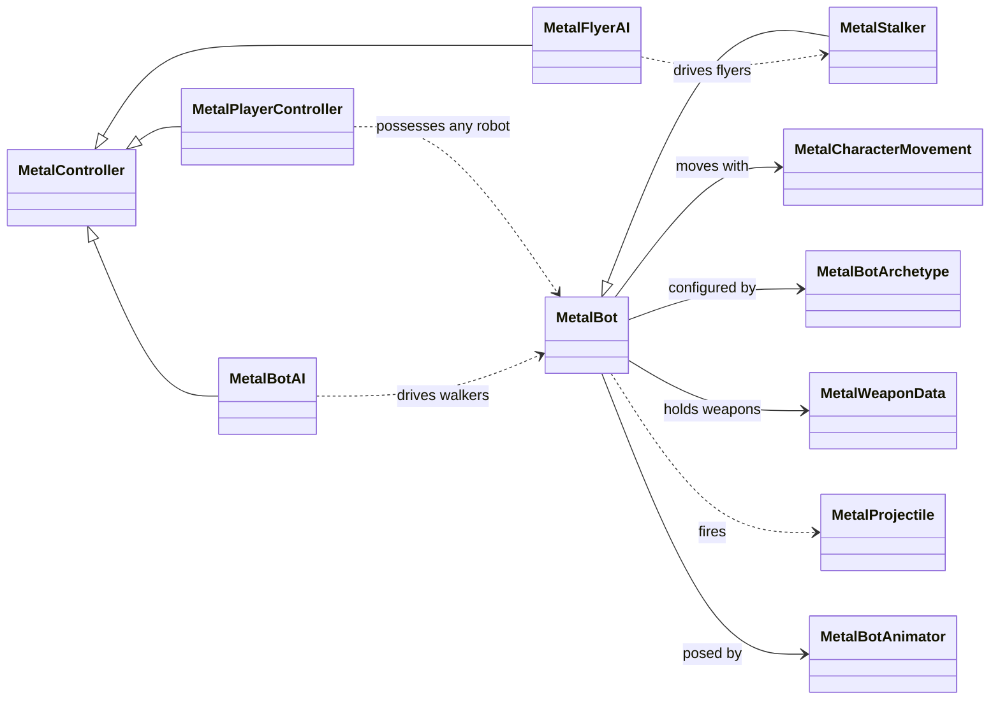
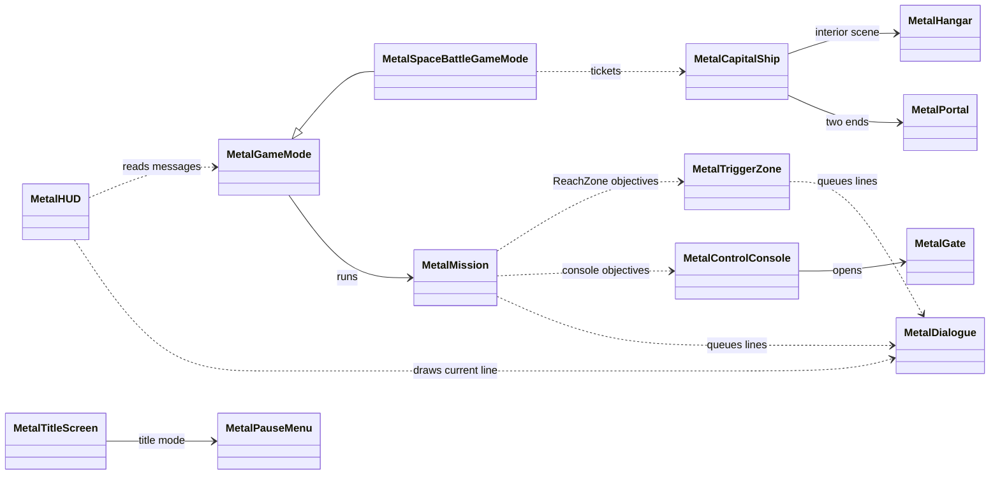

# Metalization: code architecture

This is the starting point for developers working on the C# gameplay code (Unity 6, URP). It explains how the code is laid out, the ideas that run through every system, and where to read next. The game was first written in Unreal Engine 5.8 C++; [UnityPort.md](UnityPort.md) maps the old classes and conventions to these. Each system has its own page in [`Docs/Systems/`](Systems/):

| System | Page | Main classes |
|---|---|---|
| Robots, weapons and damage | [Robots.md](Systems/Robots.md) | `MetalBot`, `MetalCharacterMovement`, `MetalBotArchetype`, `MetalWeaponData`, `MetalProjectile` |
| Procedural animation | [Animation.md](Systems/Animation.md) | `MetalBotAnimator`, `MetalBotRig` |
| Player control and the Hack Tether | [PlayerAndHacking.md](Systems/PlayerAndHacking.md) | `MetalPlayerController`, `MetalCameraRig`, `MetalHackPuzzle` |
| AI (walkers and pilots) | [AI.md](Systems/AI.md) | `MetalBotAI`, `MetalFlyerAI`, `MetalPathFollower` |
| Missions, levels, HUD and menus | [MissionsAndUI.md](Systems/MissionsAndUI.md) | `MetalGameMode`, `MetalMission`, `MetalDialogue`, `MetalCheckpoints`, `MetalHUD`, `MetalPauseMenu`, `MetalTitleScreen`, level components (`MetalTriggerZone`, `MetalControlConsole`, `MetalGate`, `MetalPickup`, `MetalGravLift`, `MetalBarrage`, `MetalEnergyField`, `MetalRobotDispenser`) |
| Audio | [Audio.md](Systems/Audio.md) | `MetalAudio`, `MetalSoundLibrary` |
| Flight | [Flight.md](Systems/Flight.md) | `MetalStalker` |
| Space battles | [SpaceBattle.md](Systems/SpaceBattle.md) | `MetalCapitalShip`, `MetalHangar`, `MetalPortal`, `MetalSpaceBattleGameMode` |
| Effects and dev tools | [EffectsAndTools.md](Systems/EffectsAndTools.md) | `MetalFX`, `MetalDevAutopilot` |

The system pages were written for the Unreal version and have had their class names updated; where they mention centimetres, `BeginPlay`, components and so on, read them through the conventions table in [UnityPort.md](UnityPort.md).

## Other documents

| Document | What it is |
|---|---|
| [UnityPort.md](UnityPort.md) | Unreal → Unity conversion: conventions, status, known differences |
| [Metalization_Plan.md](Metalization_Plan.md) | What the game is and how to play the demo levels |
| [ProductionAlpha.md](ProductionAlpha.md) | The Sprint 4 mission (Operation Redline): walkthrough, new mechanics, testing |
| [SpaceBattle_Plan.md](SpaceBattle_Plan.md) | Design history of the space battles (the implemented result is [Systems/SpaceBattle.md](Systems/SpaceBattle.md)) |
| [`Art/Graybox/README.md`](../Art/Graybox/README.md) | Layout rules for the graybox `.blend` models |

---

## 1. Where the code lives

| Folder | Assembly | Contents |
|---|---|---|
| `Assets/Metalization/Scripts/Runtime/` | `Metalization` (namespace `Metalization`) | All gameplay code, in `Core/`, `Bots/`, `AI/`, `Player/`, `Missions/`, `Level/`, `UI/`, `Space/`, `Dev/` |
| `Assets/Metalization/Scripts/Editor/` | `Metalization.Editor` | The asset pipeline and the level builders (the **Metalization** menu) |
| `Assets/Metalization/Shaders/` | | URP shaders: `Metalization/Glow`, `Particle`, `EnergyField`, `Portal` |
| `Tools/AssetPipeline/` | | Blender export, sound synthesis, `run_pipeline.ps1`, `smoke_test.ps1` |

Generated content (do not edit by hand; it is rebuilt by **Metalization > Build All Assets**): `Models/` and `Audio/` (from the Blender export and `generate_sfx.py`), `Materials/`, `Data/` (`DA_Bot_*`, `WD_*`, `DA_Sounds`, `DA_Ship_Capital`, `LevelSettings`), `Prefabs/Ships/`, `Scenes/` and `Resources/MetalGameAssets`.

Log lines from game code are prefixed `[Metal]`; the pipeline logs `[MZSetup]`, the autopilot `[Autopilot]`.

## 2. Class map

The robots and the classes that drive them:

Game flow, levels and UI:

## 3. Source files

| File | Types | Role | Page |
|---|---|---|---|
| `Core/MetalTypes.cs` | `MetalTeam`, `MetalBotRig`, `MetalFlightTuning`, `MetalTeamColors`, `MetalHitZone`, `UE`, `MetalMath` | Shared types; `UE` converts Unreal coordinates (cm, Z up) to Unity (m, Y up) | [Robots](Systems/Robots.md) |
| `Core/MetalBotArchetype.cs` | `MetalBotArchetype` | Data asset defining a kind of robot (`DA_Bot_*`) | [Robots](Systems/Robots.md) |
| `Core/MetalWeaponData.cs` | `MetalFireMode`, `MetalHeldModel`, `MetalWeaponLevel`, `MetalWeaponData` | Data asset defining a weapon and its upgrade levels (`WD_*`) | [Robots](Systems/Robots.md) |
| `Core/MetalController.cs` | `MetalController` | Base of the player and AI controllers: possession, control rotation, view point | [PlayerAndHacking](Systems/PlayerAndHacking.md) |
| `Core/MetalDamage.cs` | `IMetalDamageable`, `MetalDamageEvent`, `MetalPhysics` | Damage events, layers and masks, traces, radial damage | [Robots](Systems/Robots.md) |
| `Core/MetalAudio.cs`, `MetalSoundLibrary.cs`, `MetalSoundHandle.cs`, `MetalAmbientSound.cs` | `MetalAudio`, `MetalVolume`, `MetalSoundLibrary`, `MetalSoundHandle`, `MetalAmbientSound` | Play sounds by name from `DA_Sounds`; volume groups; level music | [Audio](Systems/Audio.md) |
| `Core/MetalFX.cs` | `MetalFX` | Code-built tracers, flashes, impacts, explosions, beams | [EffectsAndTools](Systems/EffectsAndTools.md) |
| `Core/MetalGameAssets.cs` | `MetalGameAssets`, `MetalMaterials` | Shared materials, sounds, models and the level list (`Resources/MetalGameAssets`) | |
| `Bots/MetalBot.cs` | `MetalWeaponSlot`, `MetalBark`, `MetalBot` | Every robot: weapons, damage, hit zones, sprint/sneak, weapon swap, jetpack, voice | [Robots](Systems/Robots.md) |
| `Bots/MetalCharacterMovement.cs` | `MetalMoveMode`, `MetalCharacterMovement` | Walking, jumping, crouching and flying on a `CharacterController` | [Robots](Systems/Robots.md) |
| `Bots/MetalBotAnimator.cs` | `MetalBotAnimator` | Procedural pose from the robot's state | [Animation](Systems/Animation.md) |
| `Bots/MetalProjectile.cs` | `MetalProjectile` | Bolts, rockets and grenades | [Robots](Systems/Robots.md) |
| `Bots/MetalStalker.cs` | `MetalStalker` | Flying robot: hover-gunship movement, boost, dodge, banking | [Flight](Systems/Flight.md) |
| `AI/MetalBotAI.cs` | `MetalAIState`, `MetalBotAI` | Walking robot brain: patrol, investigate, combat, retreat; hearing | [AI](Systems/AI.md) |
| `AI/MetalFlyerAI.cs` | `MetalPilotRole`, `MetalFlyerAI` | Stalker pilots: dogfight, raid ship parts, route through portals | [AI](Systems/AI.md) |
| `AI/MetalPathFollower.cs` | `MetalPathFollower`, `MetalNav` | NavMesh paths, jumps and lift rides | [AI](Systems/AI.md) |
| `Player/MetalPlayerController.cs` | `MetalPlayerController` | Input (Input System actions built in code), Hack Tether, consoles, pause | [PlayerAndHacking](Systems/PlayerAndHacking.md) |
| `Player/MetalCameraRig.cs` | `MetalCameraRig` | Over-the-shoulder spring-arm camera and the action camera | [PlayerAndHacking](Systems/PlayerAndHacking.md) |
| `Player/MetalHackPuzzle.cs` | `MetalHackResult`, `MetalHackPinType`, `MetalHackPuzzle` | The fake Blueprint window the player rewires to finish a hack | [PlayerAndHacking](Systems/PlayerAndHacking.md) |
| `Missions/MetalGameMode.cs` | `MetalMessage`, `MetalGameMode` | Spawning, mission flow, messages, checkpoints, respawn, results | [MissionsAndUI](Systems/MissionsAndUI.md) |
| `Missions/MetalMission.cs` | `MetalObjectiveType`, `MetalObjective`, `MetalMission` | Ordered objectives placed in a level | [MissionsAndUI](Systems/MissionsAndUI.md) |
| `Missions/MetalDialogue.cs` | `MetalDialogueLine`, `MetalDialogue` | Queued radio dialogue | [MissionsAndUI](Systems/MissionsAndUI.md) |
| `Missions/MetalCheckpoints.cs`, `MetalPlaced.cs` | `MetalLevelSnapshot`, `MetalCheckpoints`, `MetalPlaced` | Level snapshot at a checkpoint, restored after the reload when the player dies | [MissionsAndUI](Systems/MissionsAndUI.md) |
| `Missions/MetalPlayerStart.cs` | `MetalPlayerStart` | Player spawn point | |
| `Level/*.cs` | `MetalTriggerZone`, `MetalControlConsole`, `MetalGate`, `MetalPickup`, `MetalGravLift`, `MetalBarrage`, `MetalEnergyField`, `MetalRobotDispenser` | Level components | [MissionsAndUI](Systems/MissionsAndUI.md) |
| `UI/MetalDraw.cs` | `MetalDraw` | IMGUI drawing in 1920×1080 reference units | [MissionsAndUI](Systems/MissionsAndUI.md) |
| `UI/MetalHUD.cs`, `MetalPauseMenu.cs`, `MetalTitleScreen.cs`, `MetalLevelSettings.cs` | `MetalHUD`, `MetalPauseMenu`, `MetalTitleScreen`, `MetalLevelSettings` | HUD, pause/title menu, title screen, Level Select list | [MissionsAndUI](Systems/MissionsAndUI.md) |
| `Space/MetalCapitalShip.cs`, `MetalCapitalShipData.cs`, `MetalShipSubsystem.cs` | `MetalCapitalShip`, `MetalCapitalShipData`, `MetalShipSubsystem` | Capital ships: parts, turrets, interior scene loaded per ship | [SpaceBattle](Systems/SpaceBattle.md) |
| `Space/MetalHangar.cs` | `MetalHangar` | Hangar inside the interior: pads, parked robots, AI squadron | [SpaceBattle](Systems/SpaceBattle.md) |
| `Space/MetalPortal.cs` | `MetalPortal` | Linked see-through portals between hull and hangar | [SpaceBattle](Systems/SpaceBattle.md) |
| `Space/MetalSpaceBattleGameMode.cs` | `MetalSpaceBattleGameMode` | Spawning aboard, tickets, victory | [SpaceBattle](Systems/SpaceBattle.md) |
| `Dev/MetalDevAutopilot.cs` | `MetalDevAutopilot` | Scripted smoke tests, screenshots, fixed cameras | [EffectsAndTools](Systems/EffectsAndTools.md) |
| `Editor/MetalAssetPipeline.cs`, `MetalImportRules.cs`, `MetalJson.cs` | | Model/audio import settings; materials, data assets, sound library, ship prefabs from `manifest.json` | |
| `Editor/MetalLevelWriter.cs`, `MetalLevels*.cs` | `MetalLevelWriter`, `MetalLevels` | Level builders: every `MZ_*` scene is generated from code, in Unreal numbers | |
| `Editor/MetalBuild.cs` | `MetalBuild` | Windows player build | |

## 4. Ideas that run through every system

**One robot class for everyone.** The player, every enemy, friendly NPCs and the flyers are all `MetalBot` (or `MetalStalker`). What makes a Shooter different from a Brute is data, not code. This is what makes the Hack Tether simple: taking over an enemy is just a different controller possessing the same robot, so the hijacked robot keeps its own gun, health, hit zones and movement. Letting go gives it a fresh AI controller, so it rejoins its own side.

**Data assets hold the content.** Robots are `MetalBotArchetype` assets (`DA_Bot_*`), weapons are `MetalWeaponData` (`WD_*`), the capital ship class is `MetalCapitalShipData` (`DA_Ship_Capital`) and the sound list is `MetalSoundLibrary` (`DA_Sounds`), all in `Assets/Metalization/Data`. They are generated by `MetalAssetPipeline` (and `MetalLevels` for the level-specific ones). To tune a robot or weapon, edit the pipeline code that writes it, otherwise the next **Build All Assets** overwrites the change.

**Controllers only use the robot's public API.** The player controller and both AI controllers drive robots through the same calls: movement input, `StartFire`/`StopFire`, `SetAITarget`, `Reload`, `Jump`, sprint and sneak, and for flyers boost, dodge and vertical input. None of them reaches into robot internals, so any robot can be driven by any controller.

**Built in code, no editor assets for UI, input or effects.** The HUD and menus draw with IMGUI (`MetalDraw`), the input actions are created in `MetalPlayerController`, and effects are particle systems and line renderers built by `MetalFX`. There are no prefabs or input assets to keep in sync.

**Levels are generated.** Every scene is written by a level builder (`MetalLevels*.cs`) using `MetalLevelWriter`, which takes the Unreal version's numbers (centimetres, X forward / Y right / Z up) so the layouts match the original exactly. Change a level in its builder and rebuild it with **Metalization > Build Level**.

**Content by name.** Gameplay code never references sound clips: it plays a name through `MetalAudio.PlayAt`/`Play2D`/`PlayLoop`, looked up in `DA_Sounds`. A missing name is silent, so the game runs before the pipeline has produced any audio.

**Global events instead of references.** Systems that need to react to something anywhere in the world subscribe to static C# events rather than holding references:

| Event | Raised by | Listened to by |
|---|---|---|
| `MetalBot.AnyBotDied` | a robot dying | game mode (kill count), player controller (end hijack / player death), battle mode (tickets) |
| `MetalCapitalShip.AnyInteriorReady` | ship, once its interior scene has loaded and been moved into place | battle mode (spawns waiting players) |
| `MetalCapitalShip.AnySubsystemDestroyed` | ship | battle mode (tickets, messages) |
| `MetalCapitalShip.AnyShipDestroyed` | ship | battle mode (defeat) |

Every subscriber adds its handler in `Start`/`OnEnable` and removes it in `OnDestroy`/`OnDisable`, because the events are static and outlive the scene. The project uses Enter Play Mode options without a domain reload, so static state must be reset explicitly.

Two other world-wide services are reached by function: `MetalDialogue` (anything can queue lines) and `MetalBotAI.ReportNoise` (alerts every AI within earshot of a footstep or a shot).

**Polling on timers instead of every frame.** Expensive queries run a few times a second: AI senses every 0.2 s, flyer pilots re-think every ~0.4 s, missions check objectives every 0.25 s, turrets pick targets every 0.3 s, hangars check for dead robots every 0.5 s. Look for `next*Time` fields.

## 5. How a frame flows

1. **Input** (player) or **AI `Update`** decides what each robot wants: movement input, aim point, trigger held, sprint or sneak.
2. **`MetalBot.Update`** runs locomotion (sprint, crouch, footsteps and their noise), weapon swap, jetpack and the action camera, finishes any reload and fires the weapon if the trigger is held and ready. `MetalCharacterMovement` moves the `CharacterController`.
3. **Damage** arrives through `IMetalDamageable.TakeDamage` with a `MetalDamageEvent`. The robot checks friendly fire, finds the hit zone, applies multipliers, breaks zones, and notifies its controller.
4. **`MetalBotAnimator.LateUpdate`** resets the skeleton to its bind pose and applies the procedural pose.
5. **`MetalCameraRig`** places the camera; **`MetalHUD.OnGUI`** draws the HUD from the controller, the possessed robot, the game mode and the dialogue queue.
6. Portals move their capture cameras in `LateUpdate`, after the camera rig, so their windows match the view about to render.

## 6. Conventions

- **Units** are Unity's: metres, m/s and degrees, Y up. Values carried over from the Unreal version go through `UE.Vec`/`UE.Dir`/`UE.Rot` so the conversion is visible.
- **Time.** Fields that hold "the time when something happens next" are `Time.time` seconds named `next*Time`, `*EndTime` or `*At`; `-1` means "not scheduled".
- **Comments.** Every file starts with a `//` comment saying what it is for; public types and members have `///` summaries. Explain why, not what.
- **One `MonoBehaviour`/`ScriptableObject` per file, with the file named after it** (Unity needs this to serialize them).
- **Names.** Original-game names never appear anywhere in the project. Use the project's own names: factions Heroes/Villains (Blue/Red in the Production Alpha), robots Shooter/Soldier/Brute/Sentry/Stalker, NPC Guide, weapons Laser/Repeater/Shotgun/Hack Tether.
- **Keeping docs current.** A change to how a system works updates its page in `Docs/Systems/` in the same commit. A new file gets a row in the source file table above.

## 7. Common tasks

| I want to... | Do this |
|---|---|
| Add a new kind of robot | Add a `DA_Bot_*` archetype in `MetalAssetPipeline.BuildArchetypes` (model, rig, stats, weapons, AI tuning) and place it with `MetalLevelWriter.Bot` in a level builder. No gameplay code needed unless it needs new behaviour. |
| Add a weapon | Add a `WD_*` in `MetalAssetPipeline.BuildWeapons` with levels and held models per archetype id. Give it via `startingWeapons`, a `MetalPickup` or a mission's `playerStartingWeapons`. |
| Add a sound | Add it to `Tools/AssetPipeline/generate_sfx.py`, run it (or the pipeline), rebuild assets, and play it by name with `MetalAudio.PlayAt` or `Play2D`. |
| Add radio dialogue | Fill a `MetalTriggerZone`'s `dialogue`, an objective's `startDialogue`, the mission's `completionDialogue`, or queue lines through `MetalDialogue`. |
| Add a mission step type | Add a value to `MetalObjectiveType` and a case in `MetalMission`'s completion check (and its marker if the HUD should point at it). |
| Add a level | Write a builder in `Editor/MetalLevels*.cs`, add the scene name to `MetalLevels.SceneNames` and, for Level Select, to `MetalLevels.BuildLevelSettings`. |
| Add a level component | Follow `MetalGravLift` or `MetalGate`: build placeholder visuals from primitives in `Awake`, glow via `MetalMaterials.SetGlow`, sound via `MetalAudio`. |
| Test a change without playing | Build the player, then `Tools/AssetPipeline/smoke_test.ps1 -Scenario <name>`; or in the editor, `MetalDevAutopilot.Run("<options>")` during Play Mode. |
