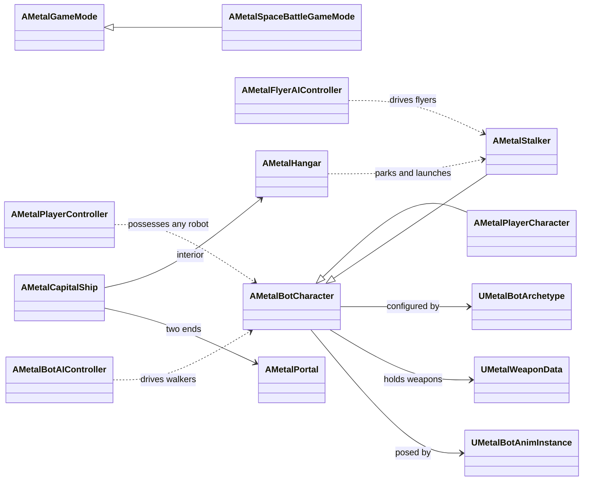

# Metalization: code architecture

This is the starting point for developers working on the C++ gameplay code. It explains how the module is laid out, the ideas that run through every system, and where to read next. Each system has its own page in [`Docs/Systems/`](Systems/):

| System | Page | Main classes |
|---|---|---|
| Robots, weapons and damage | [Robots.md](Systems/Robots.md) | `AMetalBotCharacter`, `UMetalBotArchetype`, `UMetalWeaponData`, `AMetalProjectile` |
| Procedural animation | [Animation.md](Systems/Animation.md) | `UMetalBotAnimInstance`, `FMetalBotAnimProxy`, `FMetalBotRig` |
| Player control and the Hack Tether | [PlayerAndHacking.md](Systems/PlayerAndHacking.md) | `AMetalPlayerController`, `AMetalPlayerCharacter` |
| AI (walkers and pilots) | [AI.md](Systems/AI.md) | `AMetalBotAIController`, `AMetalFlyerAIController` |
| Missions, levels, HUD and menus | [MissionsAndUI.md](Systems/MissionsAndUI.md) | `AMetalGameMode`, `AMetalMission`, `AMetalHUD`, `UMetalPauseMenu` |
| Flight | [Flight.md](Systems/Flight.md) | `AMetalStalker`, `UMetalFlightMovementComponent` |
| Space battles | [SpaceBattle.md](Systems/SpaceBattle.md) | `AMetalCapitalShip`, `AMetalHangar`, `AMetalPortal`, `AMetalSpaceBattleGameMode` |
| Effects and dev tools | [EffectsAndTools.md](Systems/EffectsAndTools.md) | `AMetalFX`, `AMetalDevAutopilot` |

For what the game is, how to run the asset pipeline and how to play the demo levels, see [Metalization_Plan.md](Metalization_Plan.md). The design history of the space battles is in [SpaceBattle_Plan.md](SpaceBattle_Plan.md).

---

## 1. Where the code lives

Everything is in the single game module `Metalization` (`Source/Metalization/`):

| Folder | Contents |
|---|---|
| `Game/` | **All Metalization gameplay code.** Every class is prefixed `Metal` (`AMetalBotCharacter`, `UMetalWeaponData`...). This is the code these docs describe. |
| `Variant_Combat/`, `Variant_Platforming/`, `Variant_SideScrolling/` | Unreal's third-person template variants, left in the module unchanged. Nothing in `Game/` depends on them. |
| `Metalization*.h/.cpp` (module root) | The template's base character, controller and game mode, plus the module definition. Also unused by `Game/`. |

`Metalization.Build.cs` adds every folder above to the include path, so headers are included by file name alone (`#include "MetalBotCharacter.h"`).

The log category for all game code is `LogMetal` (declared in `MetalTypes.h`, defined in `MetalBotCharacter.cpp`).

## 2. Class map

## 3. Ideas that run through every system

**One robot class for everyone.** The player, every enemy, friendly NPCs and the flyers are all `AMetalBotCharacter` (or a subclass). What makes a Shooter different from a Brute is data, not code. This is what makes the Hack Tether simple: taking over an enemy is just a different controller possessing the same pawn, so the hijacked robot keeps its own gun, health, hit zones and movement.

**Data assets hold the content.** Robots are `UMetalBotArchetype` assets (`DA_Bot_*`), weapons are `UMetalWeaponData` (`WD_*`), the capital ship class is `UMetalCapitalShipData` (`DA_Ship_Capital`). All live in `/Game/Metalization/Data` and are generated by the asset pipeline (`Tools/AssetPipeline/run_pipeline.ps1`). To tune a robot or weapon, edit the pipeline script that writes it (`ue_setup_gameplay.py`, `ue_setup_space.py`...), otherwise the next pipeline run overwrites the change.

**Controllers only use the robot's public API.** The player controller and both AI controllers drive robots through the same calls: `AddMovementInput`, `StartFire`/`StopFire`, `SetAITarget`, `Reload`, `Jump`, and for flyers `SetBoostHeld`/`Dodge`/`AddVerticalInput`. None of them reaches into robot internals, so any robot can be driven by any controller.

**Built in code, no editor assets for UI or input.** The HUD draws with Canvas calls, the pause menu builds its widget tree in C++, and the input actions and mapping contexts are created in `AMetalPlayerController::CreateInputObjects`. There are no widget blueprints or input assets to keep in sync. Each could be replaced by assets later without changing the gameplay code, because they only read public getters.

**Global events instead of references.** Systems that need to react to something anywhere in the world subscribe to static multicast delegates rather than holding references:

| Delegate | Fired by | Listened to by |
|---|---|---|
| `AMetalBotCharacter::OnAnyBotDied` | `AMetalBotCharacter::Die` | game mode (kill count), player controller (end hijack / player death), battle mode (tickets) |
| `AMetalCapitalShip::OnAnyInteriorReady` | ship, once its interior has streamed in | battle mode (spawns waiting players) |
| `AMetalCapitalShip::OnAnySubsystemDestroyed` | ship | battle mode (tickets, messages) |
| `AMetalCapitalShip::OnAnyShipDestroyed` | ship | battle mode (defeat) |

Every subscriber adds its handler in `BeginPlay` and removes it in `EndPlay`, because the delegates are static and outlive the world.

**Polling on timers instead of ticking everything.** Expensive queries run a few times a second rather than every frame: AI senses every 0.2 s, flyer pilots re-think every ~0.4 s, missions check objectives every 0.25 s, turrets pick targets every 0.3 s, hangars check for dead robots every 0.5 s. Look for `Next*Time` members.

**Placeholders behind one interface.** Effects (`AMetalFX`) and the animation (`UMetalBotAnimInstance`) are deliberately simple stand-ins. Every call site goes through them, so swapping in Niagara effects or authored animation is a change in one place.

## 4. How a frame flows

1. **Input** (player) or **AI tick** decides what each robot wants: movement input, aim point, trigger held.
2. **`AMetalBotCharacter::Tick`** fades hit flashes, blends the camera, applies the double-jump flip, finishes reloads, and fires the weapon if the trigger is held and the weapon is ready (`FireOnce`).
3. **Damage** arrives through Unreal's `TakeDamage`. The robot checks friendly fire, finds the hit zone, applies multipliers, breaks zones, and notifies its controller (`NotifyDamaged` / `NotifyDamageTaken`).
4. **`UMetalBotAnimInstance::NativeUpdateAnimation`** reads the robot's state and the animation proxy poses the skeleton on a worker thread.
5. **`AMetalHUD::DrawHUD`** reads the controller, the possessed robot and the game mode and draws the HUD.
6. Portals tick last (`TG_PostUpdateWork`) so their windows match the camera that is about to render.

## 5. Conventions

- Comments follow Unreal's Javadoc style: `/** */` above every class, struct, enum and function in a header, with `@param` and `@return` where they add something, and `@see` for related classes. Explanations of tricky code go in `//` comments in the `.cpp`, above the code they explain.
- Members that hold "the time when something happens next" are world-time seconds (`GetWorld()->GetTimeSeconds()`), named `Next*Time`, `*EndTime` or `*At`; `-1` or `0` means "not scheduled".
- Units are Unreal's: centimetres, cm/s and degrees. Comments say so where a value could be confused.
- Weak pointers (`TWeakObjectPtr`) are used for any reference to another actor that can be destroyed (targets, hosts, pads' robots).
- Original-game names never appear anywhere in the project. Use the project's own names: factions Heroes/Villains, robots Shooter/Soldier/Brute/Sentry/Stalker, NPC Guide, weapons Laser/Repeater/Shotgun/Hack Tether.

## 6. Common tasks

| I want to... | Do this |
|---|---|
| Add a new kind of robot | Add a `DA_Bot_*` archetype in the pipeline (mesh, rig, stats, weapons, AI tuning). Place an `AMetalBotCharacter` with that archetype. No code needed unless it needs new behaviour. See [Robots.md](Systems/Robots.md). |
| Add a weapon | Add a `WD_*` `UMetalWeaponData` with levels and held meshes per archetype id. Give it via `StartingWeapons` or an `AMetalPickup`. |
| Add a mission step type | Add a value to `EMetalObjectiveType` and a case in `AMetalMission::IsObjectiveComplete`. See [MissionsAndUI.md](Systems/MissionsAndUI.md). |
| Add a level | Create the map, add it to `MapsToCook` and to `[/Script/Metalization.MetalLevelSettings]` in `Config/DefaultGame.ini`. |
| Change a ship's special rules | Subclass `AMetalCapitalShip` and override `OnSubsystemDestroyed`, `OnShipDestroyed`, `OnInteriorReady` or `GetSpawnPoints` (all BlueprintNativeEvents). |
| Test a change without playing | Build, then `Tools/AssetPipeline/smoke_test.ps1 -Scenario <name>`. See [EffectsAndTools.md](Systems/EffectsAndTools.md). |
