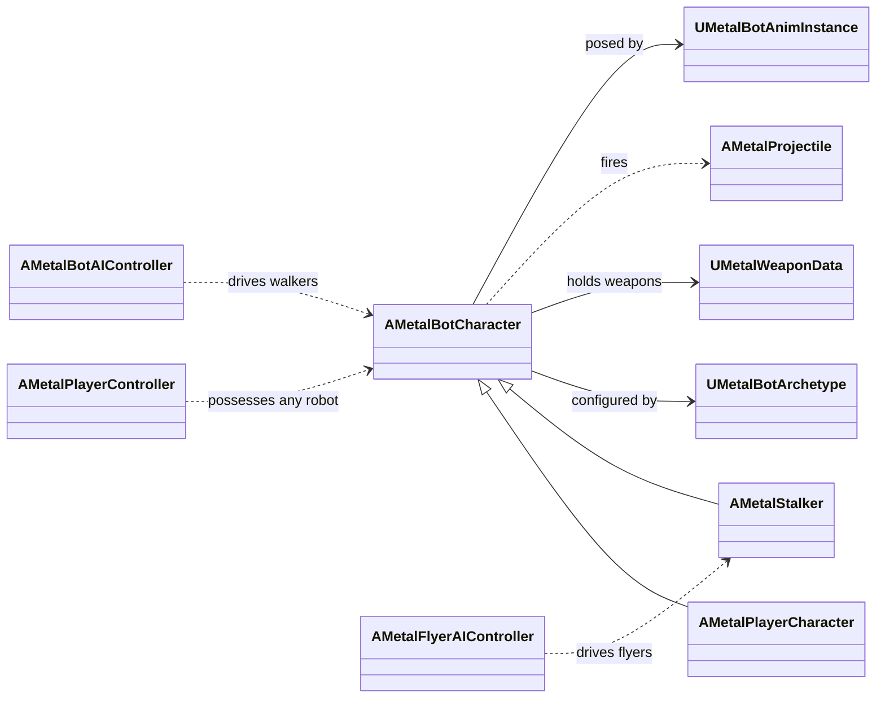
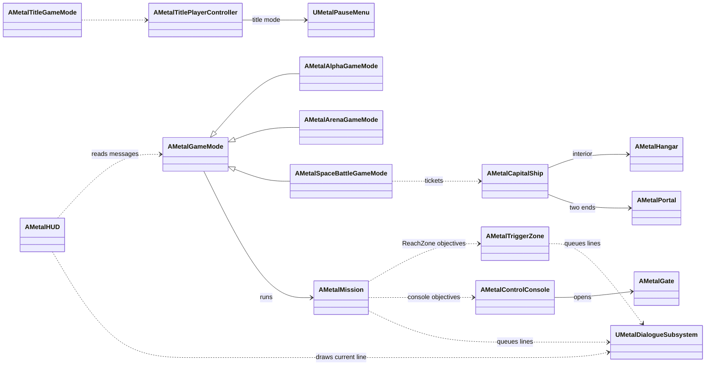

# Metalization: code architecture

This is the starting point for developers working on the C++ gameplay code. It explains how the module is laid out, the ideas that run through every system, and where to read next. Each system has its own page in [`Docs/Systems/`](Systems/):

| System | Page | Main classes |
|---|---|---|
| Robots, weapons and damage | [Robots.md](Systems/Robots.md) | `AMetalBotCharacter`, `UMetalBotArchetype`, `UMetalWeaponData`, `AMetalProjectile` |
| Procedural animation | [Animation.md](Systems/Animation.md) | `UMetalBotAnimInstance`, `FMetalBotAnimProxy`, `FMetalBotRig` |
| Player control and the Hack Tether | [PlayerAndHacking.md](Systems/PlayerAndHacking.md) | `AMetalPlayerController`, `AMetalPlayerCharacter` |
| AI (walkers and pilots) | [AI.md](Systems/AI.md) | `AMetalBotAIController`, `AMetalFlyerAIController` |
| Missions, levels, HUD and menus | [MissionsAndUI.md](Systems/MissionsAndUI.md) | `AMetalGameMode`, `AMetalMission`, `UMetalDialogueSubsystem`, `AMetalHUD`, `UMetalPauseMenu`, `AMetalTitlePlayerController`, level actors (`AMetalTriggerZone`, `AMetalControlConsole`, `AMetalGate`, `AMetalPickup`, `AMetalGravLift`, `AMetalBarrage`) |
| Audio | [Audio.md](Systems/Audio.md) | `MetalAudio`, `UMetalSoundLibrary` |
| Flight | [Flight.md](Systems/Flight.md) | `AMetalStalker`, `UMetalFlightMovementComponent` |
| Space battles | [SpaceBattle.md](Systems/SpaceBattle.md) | `AMetalCapitalShip`, `AMetalHangar`, `AMetalPortal`, `AMetalSpaceBattleGameMode` |
| Effects and dev tools | [EffectsAndTools.md](Systems/EffectsAndTools.md) | `AMetalFX`, `AMetalDevAutopilot` |

## Other documents

| Document | What it is |
|---|---|
| [Metalization_Plan.md](Metalization_Plan.md) | What the game is, the asset pipeline, and how to play the demo levels |
| [ProductionAlpha.md](ProductionAlpha.md) | The Sprint 4 mission (Operation Redline): walkthrough, new mechanics, testing |
| [Sprint4_TaskList.md](Sprint4_TaskList.md) | Sprint 4 deliverables and their status |
| [SpaceBattle_Plan.md](SpaceBattle_Plan.md) | Design history of the space battles (the implemented result is [Systems/SpaceBattle.md](Systems/SpaceBattle.md)) |
| [`Art/Graybox/README.md`](../Art/Graybox/README.md) | Layout rules for the graybox `.blend` models |

---

## 1. Where the code lives

Everything is in the single game module `Metalization` (`Source/Metalization/`):

| Folder | Contents |
|---|---|
| `Game/` | **All Metalization gameplay code.** Every class is prefixed `Metal` (`AMetalBotCharacter`, `UMetalWeaponData`...). This is the code these docs describe. |
| `Variant_Combat/`, `Variant_Platforming/`, `Variant_SideScrolling/` | Unreal's third-person template variants, left in the module unchanged. Nothing in `Game/` depends on them. |
| `Metalization*.h/.cpp` (module root) | The template's base character, controller and game mode, plus the module definition. Also unused by `Game/`. |

`Metalization.Build.cs` adds every folder above to the include path, so headers are included by file name alone (`#include "MetalBotCharacter.h"`). It also turns unity builds off (`bUseUnity = false`): several `.cpp` files define file-local constants with the same names (`Amber`, `Panel`...) in anonymous namespaces, which would collide if the files were compiled together.

The log category for all game code is `LogMetal` (declared in `MetalTypes.h`, defined in `MetalBotCharacter.cpp`).

Build the editor target from PowerShell (from Git Bash the space in `Program Files` breaks the batch file while it still reports success):

```powershell
& "C:\Program Files\Epic Games\UE_5.8\Engine\Build\BatchFiles\Build.bat" MetalizationEditor Win64 Development "-Project=$PWD\Metalization.uproject" -WaitMutex
```

## 2. Class map

The robots and the classes that drive them:



Game flow, levels and UI:



## 3. Source files

One line per header in `Game/`; the header's own top comment and class comments have the detail.

| File | Classes and types | Role | Page |
|---|---|---|---|
| `MetalTypes.h` | `EMetalTeam`, `FMetalBotRig`, `FMetalFlightTuning`, `FMetalTeamColors`, `FMetalHitZone`, `LogMetal` | Shared types used by robots, animation and flight | [Robots](Systems/Robots.md) |
| `MetalBotArchetype.h` | `UMetalBotArchetype` | Data asset defining a kind of robot (`DA_Bot_*`) | [Robots](Systems/Robots.md) |
| `MetalWeaponData.h` | `EMetalFireMode`, `FMetalWeaponLevel`, `UMetalWeaponData` | Data asset defining a weapon and its upgrade levels (`WD_*`) | [Robots](Systems/Robots.md) |
| `MetalBotCharacter.h` | `FMetalWeaponSlot`, `AMetalBotCharacter` | Every robot: weapons, damage, hit zones, sprint/sneak, weapon swap, jetpack, camera | [Robots](Systems/Robots.md) |
| `MetalPlayerCharacter.h` | `AMetalPlayerCharacter` | The player's robot class (loads `DA_Bot_Player`) | [PlayerAndHacking](Systems/PlayerAndHacking.md) |
| `MetalProjectile.h` | `AMetalProjectile` | Bolts, rockets and grenades | [Robots](Systems/Robots.md) |
| `MetalBotAnimInstance.h` | `FMetalBotAnimState`, `FMetalBotAnimProxy`, `UMetalBotAnimInstance` | Procedural pose from the robot's state, built on a worker thread | [Animation](Systems/Animation.md) |
| `MetalPlayerController.h` | `AMetalPlayerController` | Input (built in code), Hack Tether, consoles, pause | [PlayerAndHacking](Systems/PlayerAndHacking.md) |
| `MetalHackPuzzle.h` | `EMetalHackResult`, `EMetalHackPinType`, `FMetalHackNode`, `FMetalHackPin`, `UMetalHackPuzzle` | The fake Blueprint window the player rewires to finish a hack | [PlayerAndHacking](Systems/PlayerAndHacking.md) |
| `MetalBotAIController.h` | `EMetalAIState`, `AMetalBotAIController` | Walking robot brain: patrol, investigate, combat, retreat; hearing | [AI](Systems/AI.md) |
| `MetalFlyerAIController.h` | `EMetalPilotRole`, `AMetalFlyerAIController` | Stalker pilots: dogfight, raid ship parts, route through portals | [AI](Systems/AI.md) |
| `MetalStalker.h` | `UMetalFlightMovementComponent`, `AMetalStalker` | Flying robot: hover-gunship movement, boost, dodge, banking | [Flight](Systems/Flight.md) |
| `MetalGameMode.h` | `FMetalMessage`, `AMetalGameMode`, `AMetalAlphaGameMode`, `AMetalArenaGameMode` | Mission flow, messages, checkpoints, respawn, results | [MissionsAndUI](Systems/MissionsAndUI.md) |
| `MetalMission.h` | `EMetalObjectiveType`, `FMetalObjective`, `AMetalMission` | Ordered objectives placed in a level | [MissionsAndUI](Systems/MissionsAndUI.md) |
| `MetalDialogue.h` | `FMetalDialogueLine`, `UMetalDialogueSubsystem` | Queued radio dialogue | [MissionsAndUI](Systems/MissionsAndUI.md) |
| `MetalTriggerZone.h` | `AMetalTriggerZone` | Checkpoints, reach-zone targets, dialogue triggers | [MissionsAndUI](Systems/MissionsAndUI.md) |
| `MetalCheckpoint.h` | `FMetalBotSnapshot`, `FMetalLevelSnapshot`, `UMetalCheckpointSubsystem` | Level snapshot at a checkpoint, restored after the reload when the player dies | [MissionsAndUI](Systems/MissionsAndUI.md) |
| `MetalControlConsole.h`, `MetalGate.h` | `AMetalControlConsole`, `AMetalGate` | Enemy-only console that opens linked gates | [MissionsAndUI](Systems/MissionsAndUI.md) |
| `MetalPickup.h` | `EMetalPickupType`, `AMetalPickup` | Repairs, ammo, grenades, weapons and upgrades | [MissionsAndUI](Systems/MissionsAndUI.md) |
| `MetalGravLift.h` | `AMetalGravLift` | Anti-gravity lift column | [MissionsAndUI](Systems/MissionsAndUI.md) |
| `MetalBarrage.h` | `AMetalBarrage` | Artillery that chases the player through an area | [MissionsAndUI](Systems/MissionsAndUI.md) |
| `MetalHUD.h` | `AMetalHUD` | Canvas HUD | [MissionsAndUI](Systems/MissionsAndUI.md) |
| `MetalPauseMenu.h` | `UMetalMenuButton`, `UMetalPauseMenu` | Pause and title menu built in code | [MissionsAndUI](Systems/MissionsAndUI.md) |
| `MetalTitle.h` | `AMetalTitleGameMode`, `AMetalTitlePlayerController` | Title screen (`MZ_Title`) | [MissionsAndUI](Systems/MissionsAndUI.md) |
| `MetalLevelSettings.h` | `FMetalLevelEntry`, `UMetalLevelSettings` | Level Select list (Project Settings > Game) | [MissionsAndUI](Systems/MissionsAndUI.md) |
| `MetalAudio.h` | `UMetalSoundLibrary`, `MetalAudio::` functions | Play sounds by name from `DA_Sounds` | [Audio](Systems/Audio.md) |
| `MetalCapitalShip.h` | `EMetalShipSubsystem`, `UMetalCapitalShipData`, `UMetalShipSubsystemComponent`, `AMetalCapitalShip` | Capital ships: parts, turrets, streamed interior | [SpaceBattle](Systems/SpaceBattle.md) |
| `MetalHangar.h` | `AMetalHangar` | Hangar inside the interior: pads, parked robots, AI squadron | [SpaceBattle](Systems/SpaceBattle.md) |
| `MetalPortal.h` | `AMetalPortal` | Linked see-through portals between hull and hangar | [SpaceBattle](Systems/SpaceBattle.md) |
| `MetalSpaceBattleGameMode.h` | `AMetalSpaceBattleGameMode` | Spawning aboard, tickets, victory | [SpaceBattle](Systems/SpaceBattle.md) |
| `MetalFX.h` | `AMetalFX`, `MetalAssets::GetGlowMaterial` | Asset-free tracers, flashes, explosions, beams | [EffectsAndTools](Systems/EffectsAndTools.md) |
| `MetalDevAutopilot.h` | `AMetalDevAutopilot` | Scripted smoke tests, screenshots, fixed cameras | [EffectsAndTools](Systems/EffectsAndTools.md) |

## 4. Ideas that run through every system

**One robot class for everyone.** The player, every enemy, friendly NPCs and the flyers are all `AMetalBotCharacter` (or a subclass). What makes a Shooter different from a Brute is data, not code. This is what makes the Hack Tether simple: taking over an enemy is just a different controller possessing the same pawn, so the hijacked robot keeps its own gun, health, hit zones and movement. Letting go gives it a fresh AI controller, so it rejoins its own side.

**Data assets hold the content.** Robots are `UMetalBotArchetype` assets (`DA_Bot_*`), weapons are `UMetalWeaponData` (`WD_*`), the capital ship class is `UMetalCapitalShipData` (`DA_Ship_Capital`) and the sound list is `UMetalSoundLibrary` (`DA_Sounds`). All live in `/Game/Metalization/Data` and are generated by the asset pipeline (`Tools/AssetPipeline/run_pipeline.ps1`). To tune a robot or weapon, edit the pipeline script that writes it (`ue_setup_gameplay.py`, `ue_setup_space.py`...), otherwise the next pipeline run overwrites the change.

**Controllers only use the robot's public API.** The player controller and both AI controllers drive robots through the same calls: `AddMovementInput`, `StartFire`/`StopFire`, `SetAITarget`, `Reload`, `Jump`, `SetWantsSprint`, `SetSneaking`, and for flyers `SetBoostHeld`/`Dodge`/`AddVerticalInput`. None of them reaches into robot internals, so any robot can be driven by any controller.

**Built in code, no editor assets for UI or input.** The HUD draws with Canvas calls, the pause and title menu builds its widget tree in C++, and the input actions and mapping contexts are created in `AMetalPlayerController::CreateInputObjects`. There are no widget blueprints or input assets to keep in sync. Each could be replaced by assets later without changing the gameplay code, because they only read public getters.

**Content by name.** Gameplay code never references sound assets: it plays a name through `MetalAudio::PlayAt`/`Play2D`/`PlayLoop`, looked up in `DA_Sounds`. A missing name or library is silent, so the game runs before the pipeline has produced any audio. Effects work the same way: `AMetalFX` builds everything from engine shapes and one glow material.

**Global events instead of references.** Systems that need to react to something anywhere in the world subscribe to static multicast delegates rather than holding references:

| Delegate | Fired by | Listened to by |
|---|---|---|
| `AMetalBotCharacter::OnAnyBotDied` | `AMetalBotCharacter::Die` | game mode (kill count), player controller (end hijack / player death), battle mode (tickets) |
| `AMetalCapitalShip::OnAnyInteriorReady` | ship, once its interior has streamed in | battle mode (spawns waiting players) |
| `AMetalCapitalShip::OnAnySubsystemDestroyed` | ship | battle mode (tickets, messages) |
| `AMetalCapitalShip::OnAnyShipDestroyed` | ship | battle mode (defeat) |

Every subscriber adds its handler in `BeginPlay` and removes it in `EndPlay`, because the delegates are static and outlive the world.

Two other world-wide services are reached by function rather than by event: `UMetalDialogueSubsystem` (a world subsystem; anything can queue lines with `PlayDialogue`) and `AMetalBotAIController::ReportNoise` (a static call that alerts every AI within earshot of a footstep or a shot).

**Polling on timers instead of ticking everything.** Expensive queries run a few times a second rather than every frame: AI senses every 0.2 s, flyer pilots re-think every ~0.4 s, missions check objectives every 0.25 s, turrets pick targets every 0.3 s, hangars check for dead robots every 0.5 s. Look for `Next*Time` members.

**Placeholders behind one interface.** Effects (`AMetalFX`), the animation (`UMetalBotAnimInstance`) and the sounds (`MetalAudio`) are deliberately simple stand-ins. Every call site goes through them, so swapping in Niagara effects, authored animation or recorded audio is a change in one place.

## 5. How a frame flows

1. **Input** (player) or **AI tick** decides what each robot wants: movement input, aim point, trigger held, sprint or sneak.
2. **`AMetalBotCharacter::Tick`** fades the hit flash, then runs, in order: `TickLocomotion` (sprint, crouch blend, footsteps and their noise, AI laser sights), `TickWeaponSwap`, `TickJetpack`, `TickActionCamera` and `TickFlip` (which sets the final mesh transform). It then finishes any reload and fires the weapon if the trigger is held and the weapon is ready (`FireOnce`).
3. **Damage** arrives through Unreal's `TakeDamage`. The robot checks friendly fire, finds the hit zone, applies multipliers, breaks zones, and notifies its controller (`NotifyDamaged` / `NotifyDamageTaken`).
4. **`UMetalBotAnimInstance::NativeUpdateAnimation`** reads the robot's state and the animation proxy poses the skeleton on a worker thread.
5. **`AMetalHUD::DrawHUD`** reads the controller, the possessed robot, the game mode and the dialogue subsystem and draws the HUD.
6. Portals tick last (`TG_PostUpdateWork`) so their windows match the camera that is about to render.

## 6. Conventions

- **Comments** follow Unreal's Javadoc style:
  - Every header starts with a `//` comment saying what the file is for.
  - Every class, struct, enum, function, property and member variable in a header has a `/** */` comment above it, with `@param` and `@return` where they add something, and `@see` for related classes. This includes private members and component pointers: say what the member holds and its units, not just its type.
  - File-local helpers and constants in a `.cpp` (anonymous namespaces) get `/** */` comments too, since they have no header.
  - Explanations of tricky code go in `//` comments in the `.cpp`, above the code they explain. Say why, not what.
- **Time.** Members that hold "the time when something happens next" are world-time seconds (`GetWorld()->GetTimeSeconds()`), named `Next*Time`, `*EndTime` or `*At`; `-1` or `0` means "not scheduled".
- **Units** are Unreal's: centimetres, cm/s and degrees. Comments say so where a value could be confused.
- **Weak pointers** (`TWeakObjectPtr`) are used for any reference to another actor that can be destroyed (targets, hosts, pads' robots).
- **Static delegates** are subscribed in `BeginPlay` and unsubscribed in `EndPlay`.
- **Names.** Original-game names never appear anywhere in the project. Use the project's own names: factions Heroes/Villains (Blue/Red in the Production Alpha), robots Shooter/Soldier/Brute/Sentry/Stalker, NPC Guide, weapons Laser/Repeater/Shotgun/Hack Tether.
- **Keeping docs current.** A change to how a system works updates its page in `Docs/Systems/` in the same commit. A new header gets a row in the source file table above.

## 7. Common tasks

| I want to... | Do this |
|---|---|
| Add a new kind of robot | Add a `DA_Bot_*` archetype in the pipeline (mesh, rig, stats, weapons, AI tuning). Place an `AMetalBotCharacter` with that archetype. No code needed unless it needs new behaviour. See [Robots.md](Systems/Robots.md). |
| Add a weapon | Add a `WD_*` `UMetalWeaponData` with levels and held meshes per archetype id. Give it via `StartingWeapons`, an `AMetalPickup` or a mission's `PlayerStartingWeapons`. |
| Add a sound | Add it to `Tools/AssetPipeline/generate_sfx.py`, run the pipeline, and play it by name with `MetalAudio::PlayAt` or `Play2D`. See [Audio.md](Systems/Audio.md). |
| Add radio dialogue | Fill an `AMetalTriggerZone`'s `Dialogue`, an objective's `StartDialogue`, the mission's `CompletionDialogue`, or call `UMetalDialogueSubsystem::PlayDialogue`. See [MissionsAndUI.md](Systems/MissionsAndUI.md). |
| Add a mission step type | Add a value to `EMetalObjectiveType` and a case in `AMetalMission::IsObjectiveComplete` (and `GetObjectiveMarker` if the HUD should point at it). See [MissionsAndUI.md](Systems/MissionsAndUI.md). |
| Add a level | Create the map (or its pipeline script), add it to `MapsToCook` and to `[/Script/Metalization.MetalLevelSettings]` in `Config/DefaultGame.ini`. |
| Add a level actor | Follow `AMetalGravLift` or `AMetalGate`: build placeholder visuals from engine shapes in the constructor, glow via `MetalAssets::GetGlowMaterial`, sound via `MetalAudio`. |
| Change a ship's special rules | Subclass `AMetalCapitalShip` and override `OnSubsystemDestroyed`, `OnShipDestroyed`, `OnInteriorReady` or `GetSpawnPoints` (all BlueprintNativeEvents). |
| Test a change without playing | Build, then `Tools/AssetPipeline/smoke_test.ps1 -Scenario <name>`. See [EffectsAndTools.md](Systems/EffectsAndTools.md). |
