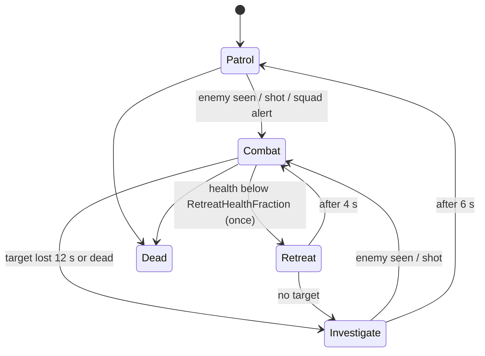

# AI

Files: `MetalBotAIController.h/.cpp` (walking robots), `MetalFlyerAIController.h/.cpp` (Stalker pilots)

Both controllers are plain C++ state machines. They drive robots only through the robot's public API (`SetAITarget`, `StartFire`/`StopFire`, movement), the same calls the player controller uses, so possession can swap a robot's controller at any time.

## Walking robots: `AMetalBotAIController`

`AMetalBotCharacter` uses this controller by default (`AIControllerClass`) and robots are auto-possessed when placed or spawned. Movement uses the navmesh.

### Sensing

`Sense()` runs every 0.2 s:

1. Re-checks line of sight to the current target and updates `LastKnownLocation`. A dead or no-longer-hostile target is dropped and the robot investigates.
2. Looks for the closest hostile robot that is within `SightRange`, inside the `SightHalfAngle` cone (or within 5 m regardless of facing), and in line of sight from the eyes. Powered-down bodies count as twice as far away, so live threats win.
3. Switches target only if not already in combat, or if the current target is a powered-down body and a live threat is visible. This stops robots wasting their fire on the player's empty body while the player attacks them in a hijacked robot.

`bPassive` robots never sense; `bDocileUntilAttacked` robots don't until they or a squadmate are shot.

### States

| State | Behaviour |
|---|---|
| Patrol | Every 3-6 s, walk to a random reachable point within `PatrolRadius` of where the robot was placed, at `PatrolSpeedFraction` of walk speed |
| Investigate | Walk to the last known enemy position, look around, return to patrol after 6 s |
| Combat | Aim at the target's chest. Alternate bursts and pauses (`BurstDuration`/`BurstPause`, randomised). Every 2-3.5 s move to a point around the target at `PreferredRange`, offset sideways so it circles instead of backing off. If sight is lost, hold fire, then chase to the last known position; give up after 12 s. If disarmed, charge and melee |
| Retreat | Run directly away for 4 s, then fight again. Happens at most once per life |
| Dead | Nothing |

**Squad alerts.** When a robot enters combat after spotting or being shot by an enemy, it calls `Alert` on every same-team AI within its archetype's `SquadAlertRadius`.

Aim error is not the controller's job: the robot adds its archetype's `AimErrorDegrees` to every AI shot.

## Pilots: `AMetalFlyerAIController`

AI Stalkers in the space battles are launched by their ship's `AMetalHangar`, which spawns them already flying and assigns a role: odd slots are **Raiders**, even slots are **Fighters**. There is no navmesh in space; the pilot steers.

### Choosing a target

`ChooseTarget()` runs about every 0.4 s (randomised so pilots don't think in sync). A live flyer target in range is kept; a raider keeps its subsystem until it is destroyed. Otherwise:

| Role | First choice | Fallback |
|---|---|---|
| Fighter | An enemy flyer near its own ship (within `DefendRadius`), else any within `EngageRange` | Raid the enemy ship |
| Raider | The enemy ship's nearest surviving subsystem in order: shield generators, engines, comms, life support, then the hull | Hunt enemy flyers |

Only flying, piloted enemy Stalkers count as flyer targets; parked ones are ignored. When hit, a pilot occasionally dodge-rolls, and a Fighter turns on a Stalker that shoots it.

### Spaces and portals

The world has several disconnected "spaces": open space, and each ship's interior (streamed 20 km above the battle). `SpaceOf()` says which space a point is in (within 600 m of a ship's `InteriorLocation` means that interior). If the pilot's target is in a different space, `RouteTo()` treats the hangar portals as navigation links:

- Inside an interior, head for that interior's hangar mouth.
- In open space, head for the target interior's ship's hull mouth.

The pilot first flies to a line-up point 60 m out in front of the mouth, then aims at a point 30 m past it, so it crosses the portal plane straight and at speed (the portal teleports it on crossing). While routing it doesn't shoot.

### Flying and fighting

Each tick, once in the same space as its target:

- **Lead.** For flyer targets, aim where the target will be after the slug's flight time.
- **Orbit.** Within 2.5x the standoff range, fly to a point on a sphere around the target: on the pilot's side, 25-35 degrees up, swaying left and right with `OrbitPhase`. The standoff is the archetype's `PreferredRange` for flyers, `StrafeRange` for subsystems (twice that for the hull). Farther away, fly straight at the target.
- **Steer.** `Steer()` applies movement input towards the move point at a throttle that eases off near it, boosts on long straight legs, and turns the nose (the control rotation) towards the aim point.
- **Avoid.** `AvoidObstacles()` sweeps a sphere 1.2 s of travel ahead. On a hit it blends the direction towards sliding along the surface, pushed off it and upwards, harder the closer the obstacle.
- **Fire.** `UpdateFiring()` fires in bursts only when the aim point is within `FireRange` and `FireCone`, and a trace shows nothing but the target in the way.

`DescribeState()` returns a one-line summary used in the dev autopilot's log.
