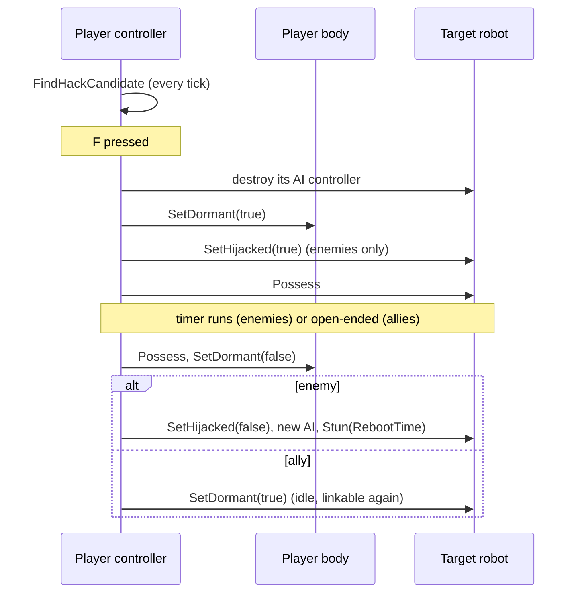

# Player control and the Hack Tether

Files: `MetalPlayerController.h/.cpp`, `MetalPlayerCharacter.h/.cpp`

`AMetalPlayerController` turns input into robot commands, runs the Hack Tether, finds consoles to interact with, and opens the pause menu.

## Input

All input objects are created in code by `CreateInputObjects` (there are no input assets). It builds two mapping contexts that share one set of actions:

| Context | Used when | Notable bindings |
|---|---|---|
| `IMC_Metalization` | Walking | WASD/left stick move, mouse/right stick look, Space jump, LMB/RT fire, RMB/LT aim, R reload, G grenade, F tether, E interact, 1-6 weapons, wheel cycles, Esc/P/Start pause |
| `IMC_MetalizationFlight` | Possessing an `AMetalStalker` | Same move/look/fire/aim/tether, Space/Ctrl climb and dive, Shift boost, Q/E dodge-roll |

`UpdateMappingContext` swaps contexts on every possession and widens the camera's pitch limits for flyers. WASD is turned into a 2D axis with Enhanced Input modifiers (swizzle W/S onto Y, negate S and A); look negates Y so pushing up looks up.

Each handler checks `CanAct()` (the possessed robot is alive, awake and not stunned) and forwards to the robot. Walking movement is relative to the camera's yaw; flying forward follows the full aim direction, so pitching up and pushing forward climbs.

## The player's body

The controller remembers two robots:

- `PlayerBody`: the player's own robot. Set in `OnPossess` whenever a possession is *not* part of a tether switch (level start, respawn).
- `Host`: the robot currently hijacked or linked, if any.

`bSwitchingBodies` is raised around the tether's own `Possess` calls so `OnPossess` can tell them apart from a fresh spawn.

## Hack Tether

**Finding a target.** `FindHackCandidate` runs every tick while the player is in their own body. It looks for robots that `CanBeHackedBy` the body, within `TetherRange`, inside a 7-degree cone around the view direction, with a clear line from the body's eyes, and picks the most centred one. The HUD shows a cyan crosshair and a "[F] HACK ..." or "[F] PILOT ..." prompt over it.

**Who can be taken.** `AMetalBotCharacter::CanBeHackedBy` has two rules:

- **Enemies** need `bHackable`. This is a *hijack*: timed by the archetype's `PossessionDuration`, the robot joins the Heroes and glows. When the link ends (F, the timer, or the player's body dying) a robot that is still alive goes back to its own side: it gets a fresh AI controller and is stunned for `RebootTime` (2 s) while it "reboots". Disconnecting never destroys it; only losing its health does.
- **Same-team robots** need `bAllyHackable` and must have no controller (an idle parked Stalker). This is a *link*: no time limit, no self-destruct, no beam. When it ends the robot goes dormant and can be linked again.

**Starting** (`BeginPossession`): the target's AI controller is unpossessed and destroyed, the body is powered down where it stands (it can still be shot), the controller possesses the target, and the control rotation is reset to the target's facing.

**Ending** (`EndPossession`) happens when the player presses F again, the hijack timer runs out (checked in `Tick`), or the host dies (`OnBotDied`). Control returns to the body if it is still alive.

**Player death.** If the player's body dies (even mid-hijack, since the body stays vulnerable), `OnBotDied` ends any link and calls `AMetalGameMode::PlayerDied`.

## Interaction

Every tick the controller finds the nearest unused `AMetalControlConsole` within its `InteractRadius`. The HUD shows its prompt; pressing E calls `TryActivate` with the possessed robot and shows the result message. See [MissionsAndUI.md](MissionsAndUI.md).

## Pause

`OpenPauseMenu` releases held buttons (their release events would be lost while the menu has input), creates `UMetalPauseMenu`, pauses the game and switches to UI-only input with the cursor shown. `ClosePauseMenu` reverses it. While the menu is open it handles its own back keys.

## Sprint, sneak and the scope

- **Sprint (Shift).** `AMetalPlayerController::SprintPressed` calls `AMetalBotCharacter::SetWantsSprint`.
  `TickLocomotion` only sprints while running forward on the ground and not aiming, firing (or within 0.4 s
  of a shot), swapping or stunned. It sets `MaxWalkSpeed` to the archetype's `SprintSpeed`. While a player
  drives a robot, `TickLocomotion` also puts back the robot's full walk speed (a hijacked robot that was
  patrolling no longer crawls).
- **Sneak (hold Ctrl, toggle C).** `SetSneaking` uses the engine's crouch. `ApplyArchetype` turns crouching
  on for archetypes with a `CrouchSpeed` and shrinks the capsule to `CrouchHeightFraction`. `TickFlip` raises
  the mesh by the amount the capsule shrank, so the feet stay on the floor. Sprinting stands the robot up.
- **Noise.** Every half stride the player's footsteps report noise to the AI (`ReportNoise`): walking 450,
  sprinting 1300, sneaking none. So do gunshots (the weapon's `NoiseRadius`).
- **Scope.** A weapon's `AimFOV`, `AimArmLengthScale` and `bScopeOverlay` drive `TickActionCamera`. With
  arm length 0 the camera moves to eye level. Once the scope is mostly up, the robot's meshes are hidden from
  its own camera (`SetOwnerNoSee`). `AimSensitivity` slows the look input
  (`GetLookSensitivityScale`, applied in `AMetalPlayerController::Look`).
- **Hitscan aim.** A player's hitscan shots are traced along the camera's aim ray and only drawn from the
  muzzle, so a gun poking into a ledge can't block the shot.
- **Grenade lob.** Player grenades lob onto the crosshair: `SuggestProjectileVelocity_CustomArc` within
  22 m, with the fuse set to land first.

## Weapon-arm swap

When a player-driven robot with `bAnimatedWeaponSwap` changes weapon, `EquipWeapon` starts a timed swap
instead of swapping at once. `TickWeaponSwap` then runs the beats:

| Time | Beat | Robot |
|---|---|---|
| 0.28 | Detach | Gun shown in the off hand (`CarriedGun`); the forearm ends in a bare mount |
| 0.5 | Rack | The old gun goes on the back rack and the new one is drawn |
| 0.8 | Attach | `CurrentWeapon` switches and the new gun is bonemerged |

- **Firing** is blocked until the swap ends.
- **Changing your mind** mid-swap retargets it.
- **Being killed or tethering away** finishes the swap instantly.
- **Placement.** `PlaceWeaponOnBone` attaches a held mesh, with no leader pose, so that its grip (the weapon
  bone in the bind pose) lands on a body bone. `RefreshRack` shows the two most recently stowed guns, using
  `FMetalBotRig::RackOffset` and `BackBone`.
- **Poses.** See [Animation.md](Animation.md).
