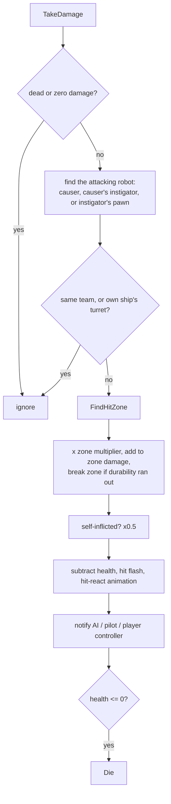

# Robots, weapons and damage

Files: `MetalBotCharacter.h/.cpp`, `MetalBotArchetype.h`, `MetalWeaponData.h/.cpp`, `MetalProjectile.h/.cpp`, `MetalTypes.h`, `MetalPlayerCharacter.h/.cpp`

Every robot in the game is an `AMetalBotCharacter`. It is an `ACharacter` that owns everything a robot can do regardless of who is driving it: health and hit zones, the weapon inventory and firing, grenades, stun / dormant / hijacked states, team paint and its third-person camera.

## The archetype: data that defines a robot

A robot does nothing without a `UMetalBotArchetype` assigned to `Archetype` (it logs an error at `BeginPlay`). The archetype holds:

| Section | What it controls |
|---|---|
| Identity | `ArchetypeId` (e.g. `"shooter"`, used to pick weapon meshes), display name, team |
| Visual | Skeletal mesh, extra `Parts` sharing the skeleton, `UnarmedPart`, scale/offset, per-team colours, the `FMetalBotRig` for the animator |
| Body | Capsule size, health, walk speed, jump height, `MaxJumps` (2 = double jump), `HitZones` |
| Combat | `StartingWeapons` (first is equipped), `MeleeWeapon` (used when disarmed), `GrenadeWeapon` and count, `MuzzleBones` for built-in guns |
| AI | Sight range and cone, preferred range, aim error, burst timing, retreat threshold, squad alert radius |
| Hacking | `bHackable`, `PossessionDuration`, `bAllyHackable` (friendly robots that accept an open-ended link) |
| Flight | `FMetalFlightTuning`, only read by `AMetalStalker` |
| Camera | Boom length and offset |

`ApplyArchetype()` copies the visual, body and camera settings onto the actor. It runs in `OnConstruction` (so the robot looks right in the editor), and again at `BeginPlay`, which also sets health, spawns the extra part meshes and gives the starting loadout.

Per-instance overrides on the actor itself: `bOverrideTeam`/`TeamOverride`, and the AI flags `PatrolRadius`, `bPassive`, `bDocileUntilAttacked`, `PatrolSpeedFraction`.

`AMetalPlayerCharacter` is the player's body. It only disables AI auto-possession and loads `DA_Bot_Player` if no archetype was set.

## Meshes: bonemerge

The body is the character's main mesh. The held weapon (`WeaponMesh`), the unarmed hand (`UnarmedMesh`) and every extra part are separate skeletal mesh components skinned to the **same skeleton**, and each uses `SetLeaderPoseComponent(GetMesh())` so it follows the body's pose exactly. The weapon mesh for a robot comes from `FMetalWeaponLevel::HeldMeshes[ArchetypeId]`, so one weapon asset carries a correctly-skinned mesh for every robot that can hold it.

The Blender exports face +Y, so the mesh is rotated -90 degrees yaw (`MeshBaseRotation`) to face the actor's +X.

## Teams

`EMetalTeam` is `Heroes`, `Villains` or `Neutral`. `GetBaseTeam()` is the archetype's team (or the override); `GetTeam()` is the current one, which becomes Heroes while a robot is hijacked. `IsHostileTo` is true for two different, non-neutral teams. Team paint (`ApplyTeamColors`) tints material slots whose names end in `_Body` or `_Accent`.

## Weapons

A weapon is a `UMetalWeaponData` asset. Shared settings (fire mode, automatic, spread, pellets, range, projectile speed and gravity, explosion radius, stun, colours) are on the asset; per-upgrade-level settings (`Levels[]`: damage, fire interval, clip size, max reserve, held meshes) are in `FMetalWeaponLevel`.

A robot's inventory is `TArray<FMetalWeaponSlot> Weapons`, each slot holding the asset, its level, and current clip and reserve.

- `GiveWeapon` adds a new weapon with a full clip and half reserve, or, if already owned, upgrades it one level and refills it. It returns whether anything changed, which is how pickups decide whether to disappear.
- `EquipWeapon` switches slot, cancels a reload and adds a 0.2 s draw delay.
- `Reload` starts a timed reload; `Tick` calls `FinishReload` when it ends.

### Firing

`StartFire()` only sets `bFireHeld`. Each `Tick`, if the trigger is held and the robot can act, `FireOnce()` runs when `NextFireTime` has passed. Semi-automatic weapons release the trigger after one shot for players.

`FireOnce()`:

1. With the weapon disabled (arm shot off) it swings the archetype's `MeleeWeapon` instead (`FireMelee`: a sphere overlap in front of the robot).
2. Picks the muzzle. Robots with built-in guns (`MuzzleBones`, e.g. the Brute's twin miniguns) cycle through them with `MuzzleCycle`, skipping guns that have been shot off.
3. Aims from the muzzle at `GetAimPoint()`: for players, a trace along the crosshair (started level with the robot so walls between camera and robot are ignored); for AI, the point set with `SetAITarget`. AI adds its archetype's aim error to the spread.
4. For each pellet, a random direction inside the spread cone:
   - **Hitscan**: line trace, beam and impact effects, `ApplyPointDamage` on whatever was hit.
   - **Projectile / Thrown**: spawns an `AMetalProjectile` with the shooter as instigator and calls `Launch`.
5. Recoil animation, hit-marker notification to the player controller, ammo use and auto-reload.

### Projectiles

`AMetalProjectile` moves with a `UProjectileMovementComponent`. Its collision ignores the `Visibility` channel so it never blocks hitscan traces, and it ignores its shooter both ways so it doesn't detonate inside them.

- Direct-hit shots apply **point damage** (so hit zones work) and are destroyed.
- Explosive shots (`ExplosionRadius > 0`) apply radial damage with falloff (full inside 30% of the radius, 25% at the edge) and stun every robot in range if the weapon has `StunDuration` (the EMP grenade).
- Thrown shots bounce, explode on a 1.6 s fuse, or immediately on touching a robot.

## Damage

`TakeDamage` is the single entry point for all damage:

### Hit zones

`FMetalHitZone` describes a region around a bone with a damage multiplier and optional durability. `FindHitZone` works in two ways:

- If the shot hit the **mesh's physics bodies** (flyers' long arms reach far outside the capsule), the hit result names a bone; the zone is the one on that bone or one of its parents.
- Otherwise the shot hit the **capsule**. The shot is treated as a ray and the zone whose bone passes closest to it, within the zone's radius, wins.

When a zone's accumulated damage passes its `Durability`, `BreakZone` runs once:

- `bDisablesWeaponWhenBroken`: the weapon is disabled; the held mesh disappears and the robot fights in melee. The walker AI notices and charges.
- `DisablesMuzzleBone`: that built-in gun stops firing and its bone is hidden (`HideBoneByName` with `PBO_Term`, which also removes its physics bodies). Losing every gun disables the weapon.

### Death

`Die` disables movement and capsule collision, ragdolls the mesh if it has a physics asset, broadcasts `OnAnyBotDied`, and schedules `Explode` 2.5 s later. `Explode` plays a burst and destroys the robot, unless the player is still controlling it, in which case it is only hidden and the game mode cleans it up on respawn. `FellOutOfWorld` is routed through `Die` so falls still count as deaths.

## States

| State | Set by | Effect |
|---|---|---|
| Dormant | `SetDormant` (the player's body during a hijack, idle flyers) | Can't move or shoot; drawn slumped |
| Stunned | `Stun` (EMP) | Can't move or shoot until `StunEndTime`; twitches |
| Hijacked | `SetHijacked` (Hack Tether) | Team becomes Heroes, hack glow pulses on the materials |
| Weapon disabled | `BreakZone` | Melee only |

`SelfDestruct(Delay)` powers the robot down and, after the delay, deals radial damage around it and kills it. Hijacked enemies do this when the link ends.

## Movement feel

- **Rotation.** Players strafe: the body turns with the controller. AI turns smoothly towards its focus (`ConfigureRotationForController`).
- **Action camera.** In levels whose game mode sets `bActionCamera` (the Arena), `TickActionCamera` blends between exploring (body faces where it runs, camera centred and pulled back), combat (over the shoulder, body faces the camera) and aiming (zoomed in, narrower FOV). Firing first squares the robot up to the crosshair.
- **Double jump.** `MaxJumps = 2` allows a mid-air jump, played as a forward somersault (`TickFlip`). The flip rotates the mesh around the capsule centre; because the mesh sits below the centre, both its offset and rotation are rotated.
- **Landing.** `Landed` plays a knee-bend scaled by the fastest fall speed.
