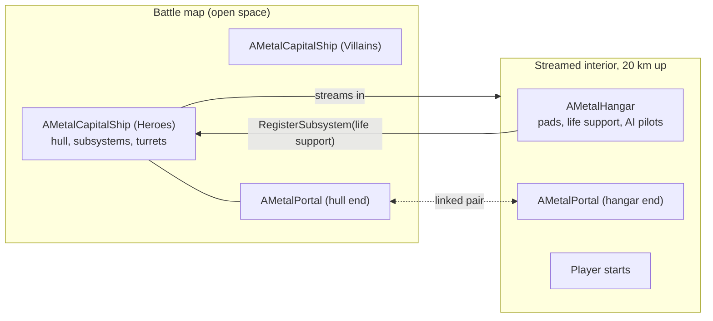

# Space battles

Files: `MetalCapitalShip.h/.cpp`, `MetalHangar.h/.cpp`, `MetalPortal.h/.cpp`, `MetalSpaceBattleGameMode.h/.cpp`
Map: `MZ_SpaceBattle` (battle) and `MZ_CapitalShip_Interior` (streamed inside each ship). Design history: [SpaceBattle_Plan.md](../SpaceBattle_Plan.md).

Two capital ships, one per team, fight in open space. Each ship has destructible subsystems and an interior hangar full of Stalkers. Players spawn aboard their ship, link to a parked Stalker, fly out through the hangar mouth, and fight alongside AI pilots and ship turrets.

## Capital ship: `AMetalCapitalShip`

### Assembly

A ship class is a `UMetalCapitalShipData` asset (`DA_Ship_Capital`): hull, engines, shield generator, comms and turret meshes, health values, team paint, the interior map, the hangar robot archetype, the hangar mouth size and the portal material.

The ship is assembled from sockets on the hull mesh:

| Socket | Part |
|---|---|
| `engines`, `shieldgen_L`, `shieldgen_R`, `comms` | The four exterior subsystems (`UMetalShipSubsystemComponent`s, created in the constructor) |
| `turret_01`, `turret_02`, ... | One turret each: a base instance plus a gun instance on the base mesh's `gun` socket |
| `hangar_portal` | The hull end of the hangar portal |

`ApplyShipData` assigns the meshes and rebuilds the turret instances; it runs in `OnConstruction` so designers see the whole ship.

Every part stops drawing beyond `DrawDistance` (15 km), so the ship can't be seen from the interiors floating 20 km away.

### Damage

| Subsystem | Effect when destroyed |
|---|---|
| Shield generators (2) | While either stands, hull damage is scaled by `ShieldedHullDamageScale` (25%) |
| Engines | The hangar's respawn delay doubles (`OnSubsystemDestroyed` default) |
| Comms | Ticket penalty only |
| Life support (in the hangar) | Ticket penalty, then the team bleeds a ticket every few seconds |

`TakeDamage` ignores damage from the ship's own team (including its own turrets' shots, which carry the ship as their owner). It finds the struck component (from a point-damage hit, or the first component a radial blast reached). A living subsystem takes the damage itself; anything else counts as hull. A destroyed subsystem is blackened, explodes, and broadcasts `OnAnySubsystemDestroyed`. At zero hull the ship broadcasts `OnAnyShipDestroyed` and breaks up in a chain of explosions.

Subsystems that live outside the ship actor, like the life support in the hangar, are added with `RegisterSubsystem` and damaged through `ApplySubsystemDamage`.

Hits flash the struck component's materials (`HitFlash` parameter), which is why every material slot gets a dynamic instance.

### Turrets

`TickTurrets` runs only if the ship data has a `TurretWeapon`.

- **Targeting** (every 0.3 s): each turret picks the nearest piloted enemy Stalker within `TurretRange` that is above the turret's horizon and visible from just above the gun.
- **Aiming** (every frame): the lead point is converted into the turret mount's frame, so yaw and pitch are relative to how the turret is mounted (top, sides, belly). The gun turns towards it at `TurretTurnRate`, with pitch limited to just above the mount's horizon.
- **Firing**: when the barrel is within 6 degrees of the lead point, the turret fires an `AMetalProjectile` with the weapon's spread plus `TurretAimError`.

A gun's transform is `Aim * TurretGunOffset * Mount * HullToWorld` (Unreal composes left to right). Only the last instance update each frame marks the render state dirty.

### Interior streaming

Both teams share one interior map. Each ship loads its own **level instance** of it (`ULevelStreamingDynamic::LoadLevelInstanceBySoftObjectPtr`) at `InteriorLocation`, which never moves even if the ship does. The interiors sit 20 km above the battle because Unreal's default KillZ is -10.5 km.

When the level is shown, `HandleInteriorShown` finds the `AMetalHangar` in it, calls `InitForShip`, creates the portals, and broadcasts `OnAnyInteriorReady`. `GetSpawnPoints` (a BlueprintNativeEvent) returns the player starts in the interior.

### Extension points

Subclass the ship (C++ or Blueprint) and override the BlueprintNativeEvents: `OnSubsystemDestroyed`, `OnShipDestroyed`, `OnInteriorReady`, `GetSpawnPoints`.

## Hangar: `AMetalHangar`

Placed in the interior map. Its shell mesh has `pad_1`, `pad_2`, ... sockets on the floor and a `hangar_portal` socket at the mouth.

- **Pads.** One pad instance per socket, each with a parked Stalker (spawned with deferred construction so its archetype, team and parked state are set before `BeginPlay`).
- **AI pilots.** The ship's `AIPilots` count of flying Stalkers, launched a couple of seconds in and staggered, hovering above the pads, each with an `AMetalFlyerAIController` (odd slots Raiders, even slots Fighters).
- **Replacements.** Twice a second, a dead pad robot or pilot schedules a replacement `RespawnDelay` seconds later. A robot that flew off its pad keeps the pad until it dies.
- **Life support.** A glowing cylinder by the back wall. The hangar registers it with its ship; its `TakeDamage` forwards point damage on the core to the ship.

Opened directly as the persistent level (for testing), the hangar initialises itself with its own settings.

## Portals: `AMetalPortal`

A hangar mouth on the hull and the matching mouth of the interior hangar, kilometres apart, are joined by a linked pair of portal actors (`AMetalCapitalShip::CreatePortals`). The hull end is attached to the hull; the interior end is spawned into the interior level.

**Frames.** Each end's +X points out of its hangar. `RoomSide` says which side of the plane is that end's own world: +1 for the hull end (open space in front), -1 for the interior end (the hangar behind). `GetSideDistance` is positive on the own side. `MapToLinked` moves a transform from one end to the same place relative to the other, so 30 m inside the interior hangar maps to 30 m inside the hull recess.

**Transit.** Every tick, each end tracks pawns and projectiles near its opening and remembers which side each was on. An actor whose side distance goes from positive to zero-or-negative inside the opening has crossed:

- Pawns are teleported to the mapped transform (kept upright: only the yaw turn applies to the body), with their velocity and control rotation rotated into the far end's frame. The chase camera's lag is switched off for two frames so it doesn't sweep across the world. The far end records the pawn as already on its own side, so it doesn't bounce straight back.
- Projectiles are destroyed (shots don't carry across yet).

**Window.** Each end's surface shows the view through the other end. A scene capture is placed where the viewer's camera would be at the far end, with the same rotation and FOV, and renders into a viewport-sized render target. The surface material samples it in screen space (`PortalTexture`), so the image lines up pixel for pixel. The capture only runs while the viewer is on the end's own side, within `CaptureDistance`, and the surface was rendered recently. It captures linear HDR so exposure and tonemapping are applied once, by the main view. The interior end hides its own ship's hull from its capture, since the view out of the hangar starts inside it.

Portals tick in `TG_PostUpdateWork`, after the camera has moved, so the window matches the frame being rendered.

## Battle rules: `AMetalSpaceBattleGameMode`

**Joining.** Players log in before the ships have begun play, so their interiors (and player starts) don't exist yet. `HandleStartingNewPlayer` queues players until every ship reports its interior ready, then starts them; after `InteriorLoadTimeout` it starts them anyway and logs an error. `ShouldSpawnAtStartSpot` returns false so the start spot cached at login isn't reused. `ChoosePlayerStart` shuffles the player starts in `PlayerTeam`'s ship and takes the first one nobody is standing on.

**Tickets.** Each team starts with `StartingTickets`.

| Event | Cost |
|---|---|
| A combatant dies: any controlled walker, or a Stalker with an AI pilot | 1 |
| A player's Stalker dies | Free (the player wakes up in their body) |
| An empty parked Stalker is destroyed | Free |
| Shield generator, engines or comms destroyed | `SubsystemTicketPenalty` (20) |
| Life support destroyed | `LifeSupportTicketPenalty` (30), then 1 every `LifeSupportBleedInterval` (4 s) |
| Ship destroyed | All remaining tickets |

A team at zero tickets loses. `EndBattle` calls `CompleteMission` with "VICTORY" or "DEFEAT" for the player's team, and the player no longer respawns.

## HUD in battle

`AMetalHUD::DrawSpaceBattle` draws each team's tickets, hull bar (blue while shielded) and one pip per subsystem across the top. Out in space it marks the way back to the home hangar mouth and the enemy hangar mouth; within 2.5 km it marks the enemy's surviving subsystems. "In space" means within 10 km of the battle plane, since the interiors are 20 km up.
